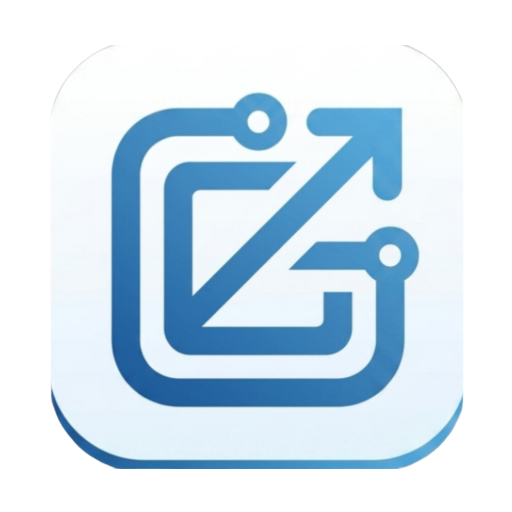

<p align="center">
  
</p>

<h1 align="center">Gettic — Sohbet Platformu</h1>

<p align="center">
  <a href="#-özellikler"></a>
  
  
  
  
  
  <a href="LICENSE"></a>
</p>

[](https://gitdiagram.com/darking053official/getticapp?utm_source=readme&utm_medium=badge)

<p align="center">
  Gizlilik odaklı, modern ve hızlı mesajlaşma uygulaması.<br/>
  <b>Flutter</b> ile geliştirilmiş, <b>Supabase</b> altyapısı üzerinde çalışır.
</p>

---

## Genel Bakış

Gettic; birebir sohbetlere odaklanan, kullanıcı verisini ön planda tutan bir mesajlaşma uygulamasıdır. Uygulama, Supabase'in sunduğu PostgreSQL, Auth, Realtime ve Storage servislerini tek bir servis katmanı üzerinden kullanır; arayüz tamamen özel, koyu renkli premium bir tema ile inşa edilmiştir. State yönetimi Riverpod ile yapılır ve tüm asenkron akışlar stream/tabanlı olacak şekilde tasarlanmıştır.

Proje; temiz katman ayrımı (sayfalar, modeller, servisler, yardımcı çekirdek bileşenler), null-safe Dart pratiği ve tutarlı bir tema sistemi üzerine kuruludur. Bu sayede yeni özellik eklemek mevcut akışları bozmadan yapılabilir.

## Özellikler

| | Özellik | Açıklama |
|---|---|---|
| 🔐 | Güvenli Kimlik Doğrulama | E-posta/şifre girişi, Google ve GitHub OAuth desteği, form doğrulama |
| 🔒 | Uçtan Uca Şifreleme | X25519 + AES-256-GCM ile mesaj ve sesler; sunucu içeriği okuyamaz |
| 💬 | Gerçek Zamanlı Mesajlaşma | Supabase Realtime ile anlık mesaj iletimi ve canlı sohbet akışı |
| ⌨️ | Yazıyor Göstergesi | Karşı taraf yazarken gerçek zamanlı bildirim |
| ✅ | Okundu Bilgisi | Mesajların okunma durumunu gösteren tek/çift tik |
| 🔔 | Okunmamış Sayaç | Sohbet listesinde okunmamış mesaj badge'i |
| 🎙️ | Sesli Mesaj | Mikrofondan kayıt, şifreli yükleme ve akıcı oynatma |
| 👥 | Grup Sohbetleri | Grup oluşturma, üye listesi, gönderen adları ve gruptan ayrılma |
| 📲 | Anlık Bildirimler | Yeni mesajlarda yerel bildirim (Android/iOS) |
| 🔍 | Kullanıcı Arama | Kullanıcı adına göre arama ve tek dokunuşla yeni sohbet başlatma |
| 👤 | Profil Yönetimi | Kullanıcı adı, durum metni ve gizlilik ayarları |
| 🌐 | Online Durum | Kullanıcıların çevrimiçi/çevrimdışı ve son görülme bilgisi |
| 🎨 | Premium Dark Tema | Lüks ve modern arayüz; Inter font ailesi ile tipografik tutarlılık |

## Mimari

```
lib/
├── main.dart            # Uygulama giriş noktası, ProviderScope kurulumu
├── core/                # Sabitler (Supabase yapılandırması), tema, yardımcılar
├── models/              # Profile, Message, Conversation veri modelleri
├── pages/               # Auth, sohbet listesi, sohbet odası, profil, ayarlar
└── services/            # SupabaseService: auth, realtime, veritabanı işlemleri
```

Veri akışı tek yönlüdür: sayfalar (`pages`) yalnızca servis katmanı ve Riverpod provider'ları üzerinden modele erişir; doğrudan Supabase çağrısı yapılmaz. Bu ayrım, altyapı değişikliklerinin tek noktadan yönetilmesini sağlar.

## Teknolojiler

| Katman | Teknoloji |
|---|---|
| Frontend | Flutter (Dart) |
| Backend | Supabase — PostgreSQL, Auth, Realtime, Storage |
| State Yönetimi | Riverpod |
| Kimlik Doğrulama | Supabase Auth (E-posta, Google, GitHub) |
| Tipografi | Google Fonts — Inter |
| Önbellek | cached_network_image |
| Güvenli Depolama | flutter_secure_storage |

## Yol Haritası

- [x] Uçtan uca şifreleme (E2EE) — v1.1
- [x] Sesli mesaj desteği — v1.1
- [x] Grup sohbetleri — v1.1
- [x] Anlık bildirim entegrasyonu — v1.1
- [x] iOS desteği — v1.1
- [ ] Grup yönetimi: üye davet/çıkarma, grup fotoğrafı — v1.2
- [ ] Uçtan uca şifreli fotoğraf mesajları — v1.2 (video: sonraki sürüm)
- [ ] FCM ile arka plan push bildirimleri

## Geliştiriciler

| Rol | Kullanıcı |
|---|---|
| Proje Geliştiricisi | [@darking053](https://git.disroot.org/darking053) |
| Katkı Sağlayan | [@anbu141](https://git.disroot.org/anbu141) |

Gettic, [@darking053](https://git.disroot.org/darking053) tarafından geliştirilmektedir; [@anbu141](https://git.disroot.org/anbu141) projeye katkı vermektedir.

## Katkıda Bulunma

Katkılara açıktır. Geliştirme akışı, commit kuralları ve pull request beklentileri için [CONTRIBUTING.md](CONTRIBUTING.md) dosyasını okuyun.

## Lisans

Bu proje [GPLv3 Lisansı](LICENSE) ile lisanslanmıştır.

---

<p align="center">
  <sub>Gettic, <a href="https://git.disroot.org/darking053">darking053</a> tarafından geliştirilmektedir · <a href="https://git.disroot.org/anbu141">anbu141</a> tarafından katkı verilmektedir.</sub>
</p>
